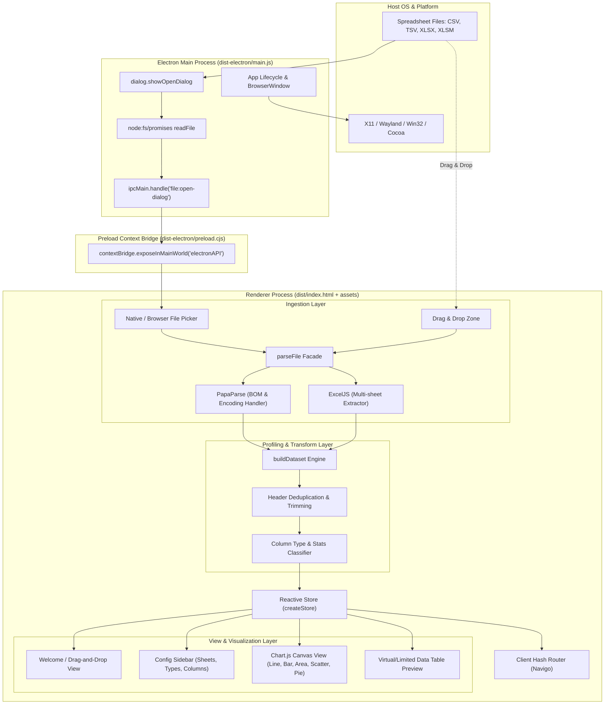

# Spreadsheet Grapher (`csv-reader`)
### System Architecture, Functional Specification & AI Agent Scorecard

---

## 1. Executive Summary

**Spreadsheet Grapher** (internal package: `csv-reader`) is a cross-platform desktop application built with **Electron**, **Vite**, and **TypeScript**. Its primary purpose is to convert raw tabular spreadsheets (CSV, TSV, XLSX, XLSM) into interactive data visualizations and analytical previews entirely offline on the client machine.

Unlike cloud-dependent visualization tools or heavy Electron wrappers around multi-megabyte JavaScript frameworks, Spreadsheet Grapher uses a **frameworkless, vanilla TypeScript DOM architecture** combined with **Tailwind CSS v4** and **Chart.js 4**. It features automated heuristic data profiling (date format inference, currency/percent detection, distinct value categorization) and intelligent default axis selection.

### Key Metadata
| Property | Value |
| :--- | :--- |
| **Product Name** | Spreadsheet Grapher |
| **Package Name** | `csv-reader` |
| **Target Runtime** | Desktop (Linux, macOS, Windows via Electron 44.7+) & Web browser dev mode |
| **Language & Tooling** | TypeScript 5.8+, Vite 8.3+, Vitest 5.0+ |
| **Styling** | Tailwind CSS v4.3+ (`@theme` design tokens) |
| **Rendering Engine** | Chart.js 4.5+ & Vanilla DOM micro-components |
| **Spreadsheet Parsers** | PapaParse 5.7+ (CSV/TSV), ExcelJS 4.4+ (XLSX/XLSM) |
| **License & Privacy** | Private / Unlicensed. 100% Local processing (zero telemetry / zero cloud transit) |

---

## 2. Architecture & Data Flow

### 2.1 Component Architecture Diagram



### 2.2 Security & Process Isolation Model
1. **Strict Context Isolation**: `contextIsolation: true` is enforced in the `BrowserWindow` configuration.
2. **Node Integration Disabled**: `nodeIntegration: false` prevents malicious scripts or dependencies in the renderer from executing arbitrary system commands.
3. **Sandboxed IPC Expose**: Only the exact required API (`openFileDialog`) is exposed across the context bridge via `contextBridge.exposeInMainWorld`.
4. **Offline Local Computation**: File bytes are read into `Uint8Array` in the main process and transferred to the renderer, where parsing and profiling execute strictly in-memory without external network calls.

---

## 3. Core Subsystems & Capabilities

### 3.1 Spreadsheet Parsing Engine
* **Supported Formats**:
  * **CSV / TSV**: Handled by `PapaParse` via [`csvParser.ts`](file:///home/admiralsheperd2442/projects/software-application/csv-reader/src/lib/parsers/csvParser.ts).
  * **XLSX / XLSM**: Handled by `ExcelJS` via [`excelParser.ts`](file:///home/admiralsheperd2442/projects/software-application/csv-reader/src/lib/parsers/excelParser.ts).
* **Encoding & BOM Disambiguation**:
  The parser inspects byte headers to detect:
  * `UTF-8` BOM (`0xEF, 0xBB, 0xBF`)
  * `UTF-16LE` BOM (`0xFF, 0xFE`)
  * `UTF-16BE` BOM (`0xFE, 0xFF`)
  * Falls back to standard UTF-8 stream decoding.
* **Workbook Multi-Sheet Support**:
  Excel workbooks with multiple worksheets are fully supported. The active sheet is switchable in real time via the UI Sheet Picker.

### 3.2 Heuristic Data Profiling & Type Inference (`dataset.ts`)
The engine performs a single-pass scan across sheet rows with strict type classification thresholds:
* **Null Value Tokens**: Automatically maps tokens like `""`, `"n/a"`, `"na"`, `"null"`, `"nan"`, `"-"`, `"#N/A"`, `"#DIV/0!"`, `"#VALUE!"`, `"#REF!"` to `null`.
* **Column Types Recognized**:
  1. **`number`**: Floating point, integer, currency (`$`, `€`, `£`, `¥`), percent (`%`).
  2. **`date`**: ISO-8601 strings, native `Date` objects, and delimited date formats. The classifier infers day-first (`dmy`) vs. month-first (`mdy`) component orders by finding discriminator values ($>12$).
  3. **`boolean`**: Case-insensitive `true`/`false`, `t`/`f`, `yes`/`no`, `y`/`n`, `1`/`0`.
  4. **`category`**: Low-cardinality string columns ($\le 200$ unique values, ratio $\le 0.5$ of total rows).
  5. **`text`**: High-cardinality free-form strings.
* **Header Normalization**:
  Prevents duplicate or blank headers by automatically generating unique names (e.g., `["Date", "Date", ""]` $\rightarrow$ `["Date", "Date (2)", "Column 3"]`).
* **Intelligent Axis Guessing**:
  * **X-Axis**: Automatically prioritizes date columns first, then categorical columns, then the first available column.
  * **Y-Axis**: Automatically selects up to the first 3 numeric columns that are not the chosen X-axis.

### 3.3 Visualizer & Chart Engine (`chartConfig.ts` & `chartView.ts`)
* **Chart Types**:
  * **Line**: Continuous trend lines with configurable curve tension.
  * **Bar**: Discrete vertical bars for categorical comparison.
  * **Area**: Semi-transparent filled area line charts.
  * **Scatter**: Numeric bivariate coordinate plots.
  * **Pie**: Proportional circular composition plots.
* **Features**:
  * Automatic downsampling of point radius when dataset rows exceed 200 items.
  * High-contrast, accessible dark/light palette mapping.
  * One-click client-side export to high-resolution PNG (`chartView.toDataURL()`).
  * Built-in `ResizeObserver` for dynamic canvas refits on window resize.

### 3.4 Data Table Preview (`dataTable.ts`)
* Displays an interactive preview of up to 500 rows.
* Sticky table headers displaying column data type and unique value counts on hover tooltips.
* Clean tabular formatting for numbers (rounded to 2 decimal places) and ISO dates.

---

## 4. Agent Technical Specifications & Data Models

### 4.1 TypeScript Domain Models (`src/shared/types.ts`)

```typescript
export type Cell = string | number | boolean | Date | null;
export type ColumnType = 'number' | 'date' | 'boolean' | 'category' | 'text';
export type ChartType = 'line' | 'bar' | 'area' | 'scatter' | 'pie';

export interface Column {
  name: string;
  index: number;
  type: ColumnType;
  nullCount: number;
  uniqueCount: number;
  min?: number;
  max?: number;
  mean?: number;
  median?: number;
  dateMin?: string;
  dateMax?: string;
  sampleValues?: string[];
  typeConfidence?: number;
}

export interface ParsedSheet {
  name: string;
  headers: string[];
  rows: Cell[][];
}

export interface ParsedWorkbook {
  fileName: string;
  sheets: ParsedSheet[];
}

export interface Dataset {
  id?: string;
  fileName: string;
  sheetName: string;
  headers: string[];
  columns: Column[];
  rows: Cell[][];
  rowCount: number;
}
```

### 4.2 State Machine & Navigation Routes
The application state is managed by a subscribe-notify store with the following state shape:
```typescript
interface AppState {
  status: 'idle' | 'loading' | 'ready' | 'error';
  error: string | null;
  workbook: ParsedWorkbook | null;
  activeSheet: number;
  dataset: Dataset | null;
  chartType: ChartType;
  xColumn: string | null;
  yColumns: string[];
}
```

**Client Routing Table**:
* `#/`: Welcome / Dashboard view with file drop target.
* `#/dataset/:id`: Dataset visualizer for the default worksheet.
* `#/dataset/:id/sheet/:sheetId`: Active worksheet view within a multi-sheet workbook.
* `#/404`: Not found route.

---

## 5. Software Engineering Scorecard & Agent Evaluation

This scorecard evaluates Spreadsheet Grapher across 7 critical dimensions on a 1–10 scale.

| Dimension | Rating | Evaluation & Highlights | Primary Areas for Growth |
| :--- | :---: | :--- | :--- |
| **1. Architecture & Design** | **9.0 / 10** | Clean decoupling between parser facade, profiling engine, and reactive views. Zero framework lock-in. | Move data profiling computation to a Web Worker for massive datasets ($>1\text{M}$ cells). |
| **2. Security & Process Isolation** | **9.5 / 10** | Context isolation enabled, nodeIntegration disabled, sandboxed IPC bridge, zero external web requests. | Add file size upload cap guard in preload before memory allocation. |
| **3. Type Inference & Profiling** | **9.5 / 10** | Best-in-class heuristics: BOM detection, date format disambiguation (`dmy` vs `mdy`), null token filtering, and deduplication. | Add user override UI to manually change column types if heuristic fails. |
| **4. Performance & Efficiency** | **8.5 / 10** | Lightweight bundle, fast cold start, minimal memory footprint compared to React/Electron setups. | Implement virtualized DOM scrolling for the table preview beyond 500 rows. |
| **5. UX, Styling & Polish** | **8.5 / 10** | Responsive Tailwind CSS v4 design tokens, dark/light theme toggle, PNG export, drag-and-drop. | Add interactive chart zoom/pan and multi-series combo charts. |
| **6. Agent Extensibility** | **9.0 / 10** | Strict TypeScript interfaces, clear module boundaries, highly readable and maintainable codebase. | Add plugin/hook interface for custom parser formats (Parquet, Arrow, JSON). |
| **7. Testing & Quality Assurance** | **6.5 / 10** | Modern Vitest configuration is present and TypeScript compilation is strict (`noEmit`, strict null checks). | Unit tests for `dataset.ts`, `csvParser.ts`, and `excelParser.ts` need to be expanded. |

### Overall Rating: **8.6 / 10 (Grade: A - Production-Ready Core)**

---

## 6. Recommendations & Roadmap for Collaborating Agents

When assigning future implementation tasks to autonomous coding agents, prioritize the following roadmap:

1. **Unit Test Suite Creation**:
   * Add automated Vitest unit tests in `tests/dataset.test.ts` to test edge cases in `normalizeHeaders()`, `guessX()`, and `guessY()`.
   * Add parser tests in `tests/parsers.test.ts` for UTF-16, malformed CSV rows, and multi-sheet Excel files.
2. **Web Worker Offloading**:
   * Wrap `buildDataset()` inside a Web Worker to keep the UI frame rate at 60 FPS when ingesting spreadsheets exceeding $500{,}000$ cells.
3. **Table Virtualization**:
   * Replace the 500-row `slice` in [`dataTable.ts`](file:///home/admiralsheperd2442/projects/software-application/csv-reader/src/components/dataTable.ts) with dynamic DOM recycling / virtual scroll windowing to preview $100{,}000+$ rows without memory degradation.
4. **Interactive Chart Controls**:
   * Integrate Chart.js zoom and pan plugins for time-series inspection.

